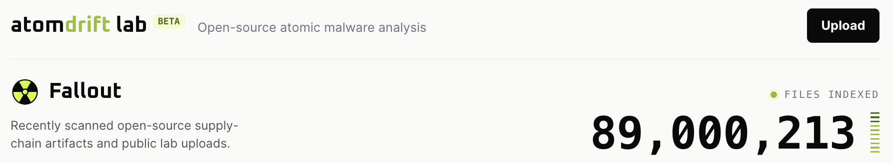
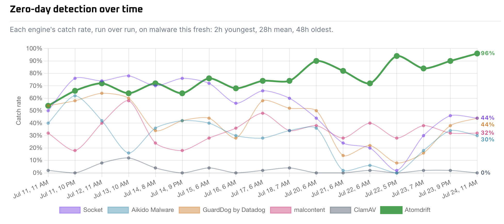

# So long Codeberg, I hardly knew ye

Trigger: https://blog.codeberg.org/protecting-our-floss-commons-from-llms.html

When I began the [Atomdrift project](https://atomdrift.org/) in early 2026; I made the bold choice to locate it's source code repository at [Codeberg](https://codeberg.org/) instead of [GitHub](https://github.com/). Why go with such an unknown entity?

- GitHub has slowly diluted to be the place for corporate development, and no longer stood for open-source.
- GitHub's reliability metrics were laughable at best.
- GitHub's approach to securing open-source was even more laughable.
- It's niche, but Codeberg offers a useful signal that "this is real community-driven open-source", not some lame attempt at corporate pandering.
- To try something new &amp; learn what Codeberg was all about.

## My experience with Codeberg

In comparison to GitHub, Codeberg excelled at virtue signalling the open-source aspect of the project, as well as providing a fun & reliable base to operate from. What Codeberg didn't seem to excel at was encouraging engagement: as best as I can tell, nobody discovered Atomdrift through Codeberg; only through other places on the Internet. The lack of an account at Codeberg was a possible impediment to engagement, but one I was OK with.

The only things I never got the hang of on Codeberg were it's Pages implementation (I never did get custom domains to work), or it's take on CI pipelines. I can only assume that Woodpecker CI is better than GitHub Actions - but since I didn't have any external contributions yet, I wasn't too concerned with CI.

## Parsing Today's Codeberg Announcement

My heart sank today when I read the "Codeberg Bans Cryptocurrency Projects" article on Hacker News. It seemed like a very arbitrary restriction, one very against my experience with open-source that says "The most successful projects are the most inclusive ones".

The cherry on top was in the comments though, that pointed at another ban, described by Codeberg at (Protecting our FLOSS commons from LLMs)[https://blog.codeberg.org/protecting-our-floss-commons-from-llms.html]. There's a lot of good stuff in there, but the most difficult part to swallow was:

* Projects that are created by LLM "agents" in autonomous ways
* Projects written and maintained with heavy use of LLMs

### The Joys of Community

First of all, the coolest thing about this announcement is that Codeberg is truly living up to being a community-led effort: these two bans were put up for a vote; and since 72% of people at the conference voted to ban LLMs; it was done.

### LLM Resource Consumption

I get it - LLM's have caused a lot of unnecessary resource usage in the ecosystem. 96.1% of access to https://lab.atomdrift.org/ is via a bot, and not a second goes by that a bot isn't crawling something or another there.

There continues to be a ton of resource waste in LLMs. However, the current situation reminds me a lot of the old  worry that every time you "using a Google Search" it would use up X houses worth of electricity. I worked at Google at the time - in a datacenter no less - and that concern was orders of magnitudes inflated. 

I think the resource usage situation will get better - it has to in order to make the economics work out for everyone. It at least did for Google Datacenters; when I started there in 2006, the average server sat at just 20% usage, which made zero sense. Then came Borg.

### Copyright Concerns

Codeberg's post also brings up the unclear copyright of AI-written source code. I feel like this is sort of a cop-out/unrelated concern, but it's a real issue. I don't put too much 
value in software copyright (IMHO, the true value of software is how it's maintained), but I acknowledge that many do.

Suffice to say, software copyrights have become weaker every year (see SCO, see Google vs Oracle); and LLM's have only made that process faster. The ability to generate code or art based on patterns from elsewhere without attribution is a troubling omission, but an understandable limitation.

There's admittedly a little bit of uncertainty around copyrighting AI-driven code; but the consensus seems to be settling around it being copyrightable as long as you've edited something yourself in the codebase - or strongly directed the AI to perform; which is still difficult to avoid today. In some respects, I think of LLMs as a non-deterministic precompiler: you still feed it the idea and the data flow, it fills in the blanks.

## Banning isn't the right answer

So, I still don't get the ban on cryptocurrency projects, but at least for LLM usage, what I would have rather seen is a policy that LLM-authored projects must declare as such (as mentioned by [I regret migrating to Codeberg](https://マリウス.com/i-regret-migrating-to-codeberg/). I'd also be happy to requried to make a donation to Codeberg to offset the impact.

The worst part about the announcement is the sudden change; what was once a safe inclusive place is now banning things arbitrarily; with no grace period. I get it though, Codeberg doesn't owe us anything: at it's core, it's an open-source project trying to find it's way in the world like so many others.

## Why the ban matters to me

As someone with a degenerative joint disease who has been hacking on projects for 35 years, I've been using LLM's as a crutch to stay in the game and keep coding. The alternative is being a software-engineering manager again, and that's not very interesting to me. I've got too many big ideas that I want to see happen, and LLMs have been a godsend for me.

Atomdrift Scan began as an LLM transpiled port of malcontent: a hand-written project I spent thousands of hours working on. malcontent was an evolutionary dead-end, in part because I wrote it in Go, and YARA - one of it's core dependencies moved to Rust, creating a poor experience for users and developers. But malcontent was also a dead-end because I knew it's hand-written rule base couldn't scalable in the age of AI-developed malware.

The fact that it began as a transpiled port means it falls afoul of this policy.

## Atomdrift's core advantage is another violation

The reason why Atomdrift Scan outperforms any malware scanner today for 0-day threats (no, seriously - [it's true!](https://atomdrift.org/compare/)) is that it's rules and models are constantly improving through a series of parallel self-reinforcement learning loops. If someone reported it as malware, and we didn't detect it, our LLM harness repairs the rules so that each malicious action is reported accurately. Similarly, benign samples are also automatically repaired to keep our default (and tunable) false-positive target at ~25 per 100,000,000 files.

## The future of LLMs in software development

LLMs use is seeing an understandable backlash in software development, not far off from the [Luddite movement](https://en.wikipedia.org/wiki/Luddite) in the 19th century. Skilled laborers, faced with automation and perceived quality lost, rebelled and destroyed the machines they were being asked to work with. Similar to software engineers, they also cited a loss in the level of skill required to produce textiles.

I think we'll eventually see LLMs to be like the use of power tools in modern day building and maintenance: there's certainly a place for them, but it's not universal. Very few houses are constructed without power tools today; but precise details are still often done by hand. The lack of precision and skilled labor is handled by the oversight of a general contractor - just as an LLM needs to be overseen by a skilled engineer. Similarly, in an auto-shop, there are places for power tools (I recently gave up and finally purchased an impact wrench to speed up wheel changes), but most work is still done by hand.

There's a lot of worry about how one trains new engineers in this day and age of LLMs. I'm not too concerned myself: even my CS classes once upon a time were done offline on a pen and paper; which irked me to no end as someone overly dependent on IDE's to catch my typos. I suspect a degree that proves you actually know how software engineering works will become more important than it was in the past. 

In this new world, on the job experience will happen much the way it does now - one failure at a time.

## Why Codeberg's decision should matter to you.

I know I'm just a small fish, just some Internet rando with a bizarre set of open-source projects. 

However, when you see a community-driven project you depend on instituting sudden bans, you should be worried! It's not any different than a homeowners association that picks new rules based on a vote of who's present at that month's meeting. Not only will you feel uneasy building your community on unsteady ground, but so will every one else there.

In the end, the thing that matters the most to the health of an open-source project is inclusion. Whether it's the ability to constantly attract new contributors through excellent communication, or the ability to attract new users through excellent documentation.

So, I guess that means I'm moving to GitHub - and writing some documentation (by hand, not by LLM).
